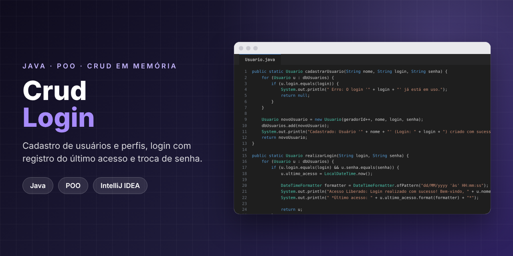
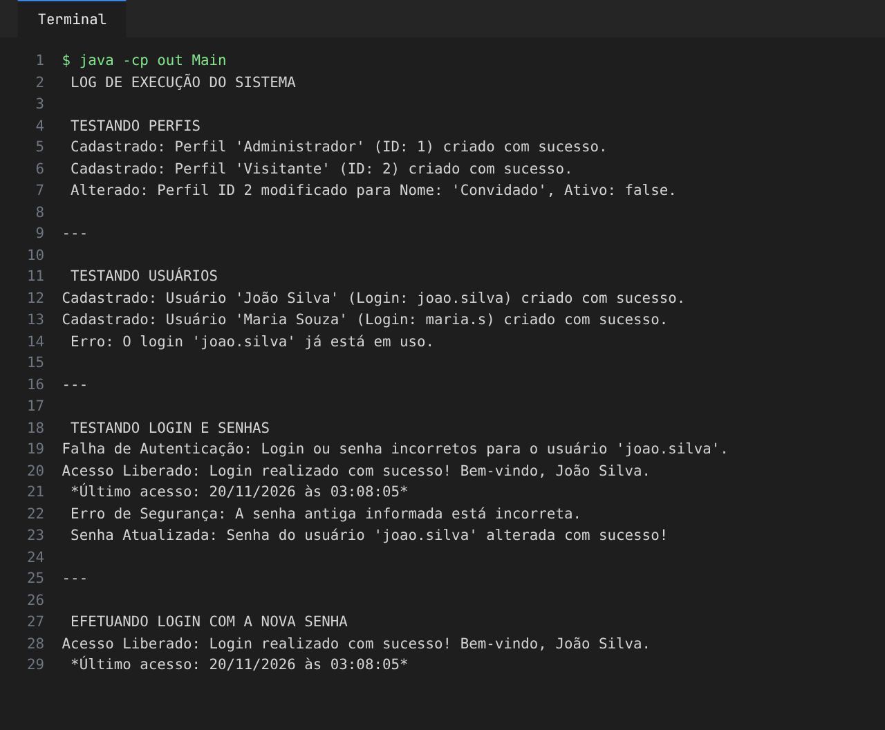

<p align="center">
  
</p>

<h1 align="center">🔐 Crud Login — Autenticação e Gestão de Perfis</h1>

<p align="center">
  Projeto em <b>Java</b> que simula um sistema de autenticação de usuários e gerenciamento de perfis, com os dados
  guardados <b>em memória</b>, para praticar os fundamentos de <b>Programação Orientada a Objetos</b>.
</p>

<p align="center">
  
  
  
  
</p>

<p align="center">
  <a href="#-sobre-o-projeto">Sobre</a> •
  <a href="#-funcionalidades">Funcionalidades</a> •
  <a href="#-telas">Saída</a> •
  <a href="#-como-executar">Como executar</a> •
  <a href="#-estrutura-do-projeto">Estrutura</a>
</p>

---

## 📌 Sobre o projeto

O objetivo é demonstrar conceitos fundamentais de **POO**: classes, **encapsulamento** (atributos privados e
getters), **modificadores de acesso** (o construtor de `Usuario` é privado e só é usado pelo método de cadastro) e
**métodos e atributos estáticos**, que fazem o papel de um "banco de dados" em memória (`List` estática e gerador de
IDs).

O projeto foi construído com base em um diagrama de classes, com as entidades:

- **`Usuario`**: guarda as credenciais e os dados do usuário e concentra a lógica de cadastro, login e troca de senha.
- **`Perfil`**: define os níveis de acesso da aplicação e o seu estado (ativo/inativo).
- **`Main`**: instancia os objetos e testa o fluxo completo, simulando um uso real.

> As senhas ficam em texto puro na memória: é um projeto de estudo de POO, não um sistema de autenticação para
> produção.

## ✨ Funcionalidades

| | Método | Descrição |
|---|---|---|
| 🏷️ | `Perfil.cadastrarPerfil()` | Cria um nível de acesso (ex.: Administrador, Visitante) com ID automático |
| ✏️ | `Perfil.alterarPerfil()` | Altera o nome e o status de ativação do perfil |
| 👤 | `Usuario.cadastrarUsuario()` | Registra um usuário e impede logins duplicados |
| 🔑 | `Usuario.realizarLogin()` | Verifica login e senha e registra a data e a hora do último acesso |
| 🔒 | `alterarSenha()` | Troca a senha somente se a senha antiga informada estiver correta |

## 🖼️ Telas

Log real de execução da classe `Main`:

<p align="center">
  
</p>

## 🚀 Como executar

**Pré-requisito:** um JDK instalado (testado com o JDK 21). Não há dependências externas.

### Pelo terminal

```bash
git clone https://github.com/kauaxp77/Crud_login.git
cd Crud_login
javac -d out src/*.java
java -cp out Main
```

### Pela IDE

O repositório já é um projeto do **IntelliJ IDEA** (`Crud_login.iml` e pasta `.idea`): basta abrir a pasta, escolher
um JDK e executar a classe `Main`. Em outras IDEs (Eclipse, VS Code), marque `src` como pasta de código-fonte.

> **Encoding:** para os acentos aparecerem corretamente no log, deixe o terminal da IDE em **UTF-8**.

## 📁 Estrutura do projeto

```
Crud_login/
├── src/
│   ├── Main.java       # Simulação do fluxo: perfis, usuários, login e troca de senha
│   ├── Usuario.java    # Credenciais, cadastro, login e alteração de senha
│   └── Perfil.java     # Níveis de acesso e status ativo/inativo
├── docs/
│   ├── banner.png
│   └── screenshots/
├── .idea/              # Configuração do projeto no IntelliJ IDEA
└── Crud_login.iml
```

## 🛠️ Tecnologias

- **Java** (somente a biblioteca padrão)
- `java.util.ArrayList` / `List` para o armazenamento em memória
- `java.time.LocalDateTime` e `DateTimeFormatter` para o registro do último acesso
- **IntelliJ IDEA**

## 👨‍💻 Autor

Desenvolvido por **[kauaxp77](https://github.com/kauaxp77)**

<p align="center">⭐ Se curtiu o projeto, deixe uma estrela!</p>
